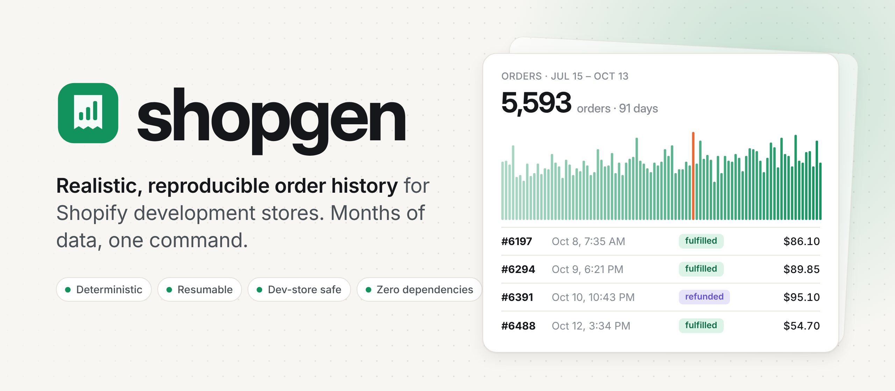
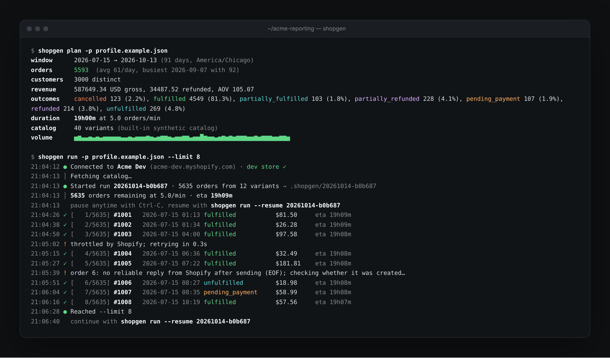
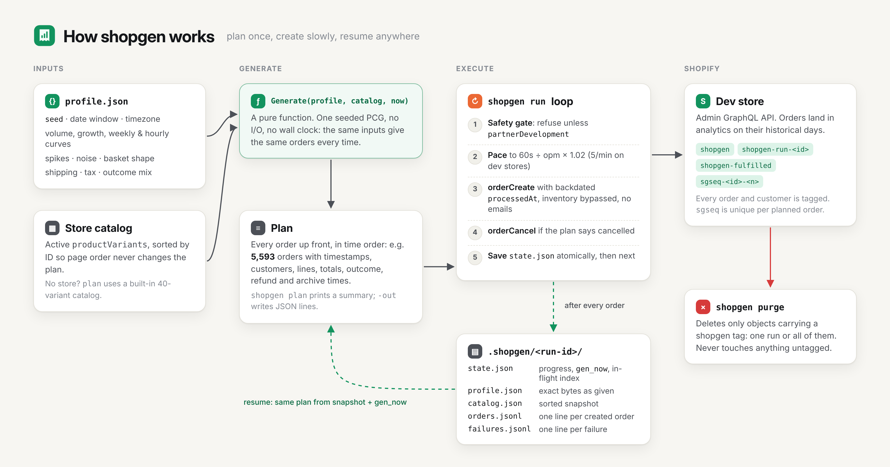
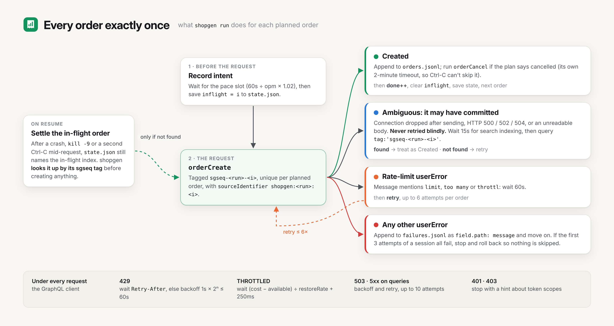

<!-- Generated from README.md by scripts/sync-docs.py. Edit the README, then run `make docs-sync`. -->

# shopgen { .sg-visually-hidden }

<p align="center">
  <picture>
    <source media="(prefers-color-scheme: dark)" srcset="assets/header-dark.png">
    
  </picture>
</p>

<p align="center">
  <a href="https://github.com/weekwright/shopgen/actions/workflows/ci.yml"></a>
  <a href="https://pkg.go.dev/github.com/weekwright/shopgen"></a>
  <a href="https://github.com/weekwright/shopgen/blob/main/go.mod"></a>
  <a href="https://github.com/weekwright/shopgen/blob/main/LICENSE"></a>
</p>

**shopgen** backfills months of realistic order history into a Shopify development store, so reports, dashboards, syncs and apps have something real to chew on. You get growth trends, weekly cycles, sales spikes, repeat customers, refunds and cancellations, all landing on the right days in Shopify analytics.

```sh
shopgen doctor               # check credentials, scopes and catalog
shopgen plan                 # preview 90 days of orders, no writes
shopgen run --limit 3        # smoke test: create 3 orders
shopgen run                  # create them all, paced to Shopify's dev-store limit
shopgen purge --run <id>     # remove everything that run created
```

<p align="center"></p>

## Why


An empty dev store makes every report look the same: flat. Hand-made test orders all land "today", carry no history, and never get refunded. shopgen generates a whole history up front from a small JSON profile, then creates it through the Admin API with backdated `processedAt`, so the orders appear in analytics on their historical days.

- **Realistic.** Trend, day-of-week and hour-of-day curves, spikes, lognormal noise, Zipf-distributed best sellers, preferential-attachment repeat buyers, tax, free-shipping thresholds, and seven order outcomes with backdated refunds and archiving.
- **Reproducible.** Same profile + same catalog = the same orders, every time. A plan is a pure function of its inputs.
- **Survives overnight runs.** Dev stores allow 5 creates per minute, so 90 days takes about 19 hours. Stop it, crash it, `kill -9` it: resume picks up with no gaps and no duplicates.
- **Safe.** Refuses to write to anything but a development store, checks the token's scopes before writing, never emails anyone, never touches inventory, and `purge` removes only what it tagged.
- **Easy to connect.** Works with a legacy `shpat_` token, or mints and refreshes its own tokens from a Dev Dashboard app's client ID and secret.

## Quick start


**1. Install.** With Go 1.24 or later:

```sh
go install github.com/weekwright/shopgen@latest
```

or download a binary from [Releases](https://github.com/weekwright/shopgen/releases).

**2. Connect a dev store.** Create a [development store](https://help.shopify.com/en/partners/dashboard/managing-stores/development-stores) with a few active products, and an app with the `read_products`, `write_orders` and `write_customers` Admin API scopes. [docs/shopify-setup.md](shopify-setup.md) walks through it. Then give shopgen one of:

```sh
export SHOPIFY_STORE=my-dev-store            # .myshopify.com is added for you

# a Dev Dashboard app: shopgen fetches and refreshes 24-hour tokens itself
export SHOPIFY_CLIENT_ID=…
export SHOPIFY_CLIENT_SECRET=…

# or an existing Admin API token (legacy custom apps)
export SHOPIFY_ACCESS_TOKEN=shpat_…
```

Secrets are read from the environment only, never from flags or config files.

**3. Check everything.** `doctor` verifies credentials, the connection, the dev-store flag, granted scopes and your catalog, without writing anything.

```sh
shopgen doctor
```

```text
✓ profile      profile.json is valid
✓ credentials  client credentials token, valid until Oct 15 16:27 (refreshed automatically)
✓ store        Acme Dev (acme-dev.myshopify.com), Admin API 2026-10
✓ dev store    partner development store: writes allowed
✓ scopes       read_products, write_orders, write_customers granted
✓ catalog      12 active variants
✓ currency     USD
✓ plan         5570 orders, about 18h56m at 5.0/min

Ready to run.
```

**4. Write a profile and preview it.** Start from the example (90 days, 60 orders a day, +25% growth, a Labor Day spike). `plan` prints what it would create; nothing is written.

```sh
curl -fsSLo profile.json https://raw.githubusercontent.com/weekwright/shopgen/main/profile.example.json
shopgen plan
```

```text
window      2026-07-15 → 2026-10-13 (91 days, America/Chicago)
orders      5593  (avg 61/day, busiest 2026-09-07 with 92)
customers   3000 distinct
revenue     587649.34 USD gross, 34487.52 refunded, AOV 105.07
outcomes    cancelled 123 (2.2%), fulfilled 4549 (81.3%), partially_fulfilled 103 (1.8%), ...
duration    19h00m at 5.0 orders/min
```

Without a store, `plan` uses a built-in 40-variant catalog, so you can design a profile before connecting anything.

**5. Smoke test, then run.**

```sh
shopgen run --limit 3            # three orders: check them in the admin
shopgen run --resume <run-id>    # carry on with the same run
```

Press Ctrl-C at any time. shopgen finishes the order in flight, saves its place and prints the exact resume command. A second Ctrl-C abandons the in-flight request; resume works out whether it landed.

**6. Clean up.**

```sh
shopgen purge --run <run-id>     # or: shopgen purge --all
```

## How it works


<picture>
  <source media="(prefers-color-scheme: dark)" srcset="assets/architecture-dark.png">
  
</picture>

1. **Generate.** `Generate(profile, catalog, now)` builds the entire history in memory: every order's timestamp, customer, lines, totals and outcome. It uses one seeded PRNG and no I/O, and the catalog is sorted by variant ID, so the result never depends on API page order or the wall clock.
2. **Snapshot.** A new run gets an ID like `20261014-a1b2c3` and a directory in `.shopgen/` holding the exact profile bytes, the sorted catalog and `gen_now`, the reference time it was generated with.
3. **Create.** The loop paces `orderCreate` calls to 5 per minute (plus 2% headroom), cancels the orders the plan says are cancelled, and rewrites `state.json` atomically after every order.
4. **Resume.** Resume never re-reads your profile or re-fetches the catalog. It regenerates the identical plan from the snapshot and `gen_now` and continues from the next index.

Every order carries a unique `sgseq-<run>-<index>` tag. When a create may have committed but no reply arrived (a dropped connection, a 502), shopgen looks the order up by that tag instead of retrying blindly. That's how a run stays free of duplicates even across crashes.

<picture>
  <source media="(prefers-color-scheme: dark)" srcset="assets/lifecycle-dark.png">
  
</picture>

More detail, including the volume formula, the GraphQL client's retry rules and the code layout: [docs/how-it-works.md](how-it-works.md).

## Profiles


A profile is one JSON file. Everything except `start` and `orders_per_day` has a default, and invalid values are rejected at load time with a message naming the field.

```json
{
  "seed": 42,
  "start": "2026-07-15",
  "end": "2026-10-13",
  "timezone": "America/Chicago",
  "orders_per_day": 60,
  "growth": 0.25,
  "spikes": [{ "date": "2026-09-07", "days": 1, "multiplier": 2.2 }],
  "tax_rate": 0.0825,
  "customers": { "pool": 3000, "repeat_rate": 0.32 },
  "items": { "min": 1, "max": 5 },
  "free_shipping_over": 75,
  "archive_fulfilled": true
}
```

<picture>
  <source media="(prefers-color-scheme: dark)" srcset="assets/volume-dark.png">
  
</picture>

Daily volume is the mean × a linear growth trend × the weekday multiplier × any spike × lognormal noise. Each order then gets an hour from an evening-peaked curve, a customer, a basket, shipping, tax and an outcome. See the [profile reference](profile.md) for every field. [`examples/`](https://github.com/weekwright/shopgen/tree/main/examples) has ready-made profiles for a smoke test, a holiday season and a refund-heavy store.

## What the orders look like


| Outcome | Default share | `financialStatus` | `fulfillmentStatus` | Transactions | After create |
|---|---|---|---|---|---|
| `fulfilled` | 82% | `PAID` | `FULFILLED` | sale | |
| `unfulfilled` | 4% | `PAID` | | sale | |
| `partially_fulfilled` | 2% | `PAID` | `PARTIAL` | sale | |
| `pending_payment` | 2% | `PENDING` | | none | |
| `refunded` | 4% | `REFUNDED` | `FULFILLED` | sale + full refund | |
| `partially_refunded` | 4% | `PARTIALLY_REFUNDED` | `FULFILLED` | sale + partial refund | |
| `cancelled` | 2% | `PAID` | | sale | `orderCancel` |

Recent orders skew unfulfilled, as in a real store: an order younger than `fulfillment_lag_days` is still unfulfilled with probability `1 − age/lag`. Refunds land 2–20 days after the sale, and with `archive_fulfilled` orders are closed 3–10 days later.

Every order is tagged `shopgen`, `shopgen-run-<id>`, `shopgen-<outcome>` and `sgseq-<id>-<index>`, and has `sourceIdentifier: shopgen:<id>:<index>`. Customers are upserted by email (`first.last.<n>@shopgen.example`), so repeat orders link to one customer, and are tagged too. Addresses are real US city/state/ZIP combinations so address validation passes.

## Safety


- **Dev stores only.** Before any write, shopgen checks `shop.plan.partnerDevelopment` and stops if it's false. `--allow-non-dev` overrides this for paid staging stores.
- **Scopes first.** Before any write, shopgen lists the token's granted scopes and stops if one is missing, rather than failing on order one.
- **No emails, no stock changes.** Every create sends `sendReceipt: false`, `sendFulfillmentReceipt: false` and `inventoryBehaviour: BYPASS`; cancellations use `notifyCustomer: false`.
- **Undeliverable addresses.** `email_domain` must be a reserved domain (`.example`, `.test`, `.invalid`, `example.com`, …), so no generated email can reach a real inbox.
- **Secrets stay out of history and files.** Tokens and client secrets are read only from the environment.
- **Purge is scoped.** It only deletes objects carrying a shopgen tag and asks you to type `delete` first.

## Known limits


These are deliberate in v1:

- **Refunds are transactions, not Refund objects.** Financial reports see them; line-level return reports don't.
- **`cancelledAt` is the run's time.** Shopify sets it when `orderCancel` runs; it can't be backdated.
- **Today's prices.** Every line uses the variant's current price; there are no discount codes yet.
- **US addresses only**, and amounts assume a two-decimal currency.
- **One order per call.** The 5/min cap makes batching pointless on dev stores; paid staging stores can raise `--opm` together with `--allow-non-dev`.

## FAQ


**Why does a 90-day profile take 19 hours?** Shopify caps `orderCreate` at 5 calls per minute on development and trial stores. `plan` and `doctor` print the duration up front. Run it overnight in `tmux` or `screen`; it's built to be stopped and resumed.

**My Dev Dashboard token expires after 24 hours. Will a long run fail?** No. With `SHOPIFY_CLIENT_ID` and `SHOPIFY_CLIENT_SECRET` set, shopgen renews the token five minutes before it expires, and again on any `401`.

**Will the same profile give the same orders next week?** For a window that ended more than `fulfillment_lag_days` ago, yes, exactly. Generation takes "now" as an input (orders can't be in the future, and recent ones skew unfulfilled), so a window ending today shifts slightly as the clock moves. A run records its `gen_now` once and reuses it on every resume, so a run's plan never changes.

**Can I point it at my production store?** Not by accident: it refuses non-dev stores unless you pass `--allow-non-dev` on the command line. Please don't.

**Do test orders show up in analytics?** Shopify hides `test: true` orders from analytics, so shopgen sends `test: false` by default. Set `"test_orders": true` if you want them flagged.

**What if my store has no products?** `doctor` and `run` stop with a message asking you to add some. shopgen reads your catalog; it never creates products.

## Built with


[cobra](https://github.com/spf13/cobra) and [viper](https://github.com/spf13/viper) for the command line and configuration, [lipgloss](https://github.com/charmbracelet/lipgloss) for terminal styling, and [go-shopify](https://github.com/bold-commerce/go-shopify) for store-name helpers and the access-scopes endpoint. Order creation uses shopgen's own small GraphQL client in [`internal/shopify`](https://github.com/weekwright/shopgen/tree/main/internal/shopify), because its retry rules (never resend a mutation that may have committed) are the core of the exactly-once guarantee.

## Contributing


Issues and pull requests are welcome. See [CONTRIBUTING.md](https://github.com/weekwright/shopgen/blob/main/CONTRIBUTING.md). The test suite runs offline against a fake Admin API ([`shopifytest`](https://github.com/weekwright/shopgen/tree/main/internal/shopify/shopifytest)):

```sh
make check      # gofmt, go vet, go test -race
```

## License


[MIT](https://github.com/weekwright/shopgen/blob/main/LICENSE). shopgen is an independent project and is not affiliated with or endorsed by Shopify.
