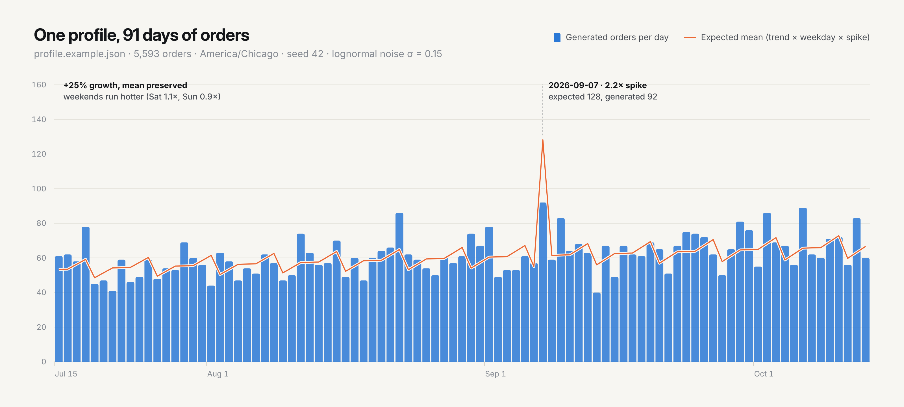

# Docs UI kit

The docs site is [Material for MkDocs](https://squidfunk.github.io/mkdocs-material/) with a small design system on top. This page shows every token and component, and doubles as a visual test: if something here looks wrong, the site does too.

> [!NOTE]
> This page is written for the docs site. On github.com the components below render as plain HTML.

## How it fits together

| Layer | File | What it does |
|---|---|---|
| Tokens | [`docs/stylesheets/tokens.css`](https://github.com/weekwright/shopgen/blob/main/docs/stylesheets/tokens.css) | Every color, radius, shadow and spacing value, for light and dark, mapped onto Material's variables |
| Components | [`docs/stylesheets/components.css`](https://github.com/weekwright/shopgen/blob/main/docs/stylesheets/components.css) | Chrome, typography, code, tables, callouts and the `sg-*` components below. Reads only tokens |
| Landing page | [`overrides/home.html`](https://github.com/weekwright/shopgen/blob/main/overrides/home.html) | Hero, feature cards and workflow steps, above the README-generated body |
| Build hooks | [`hooks/sg_hooks.py`](https://github.com/weekwright/shopgen/blob/main/hooks/sg_hooks.py) | Turns GitHub alerts into callouts, and README `<picture>` diagrams into images that follow the color toggle |
| Generated pages | [`scripts/sync-docs.py`](https://github.com/weekwright/shopgen/blob/main/scripts/sync-docs.py) | Builds `index.md` and `commands.md` from `README.md` |

Rules of thumb:

- **Write GitHub-flavored Markdown.** Pages must read well on github.com too. Use GitHub alerts and `<picture>` for themed images; the hooks translate them.
- **Components only read tokens.** Never hard-code a color in a component; add a token for both schemes instead.
- **Light and dark ship together.** Check both with the toggle in the header before merging.

## Tokens

Colors are defined twice, for `default` (light) and `slate` (dark), and switch with the toggle. Each chip below is painted with the live token.

<div class="sg-swatches" markdown>
<div class="sg-swatch"><div class="sg-swatch__chip" style="background:var(--sg-bg)"></div><span class="sg-swatch__name">--sg-bg</span></div>
<div class="sg-swatch"><div class="sg-swatch__chip" style="background:var(--sg-surface)"></div><span class="sg-swatch__name">--sg-surface</span></div>
<div class="sg-swatch"><div class="sg-swatch__chip" style="background:var(--sg-surface-2)"></div><span class="sg-swatch__name">--sg-surface-2</span></div>
<div class="sg-swatch"><div class="sg-swatch__chip" style="background:var(--sg-line)"></div><span class="sg-swatch__name">--sg-line</span></div>
<div class="sg-swatch"><div class="sg-swatch__chip" style="background:var(--sg-ink)"></div><span class="sg-swatch__name">--sg-ink</span></div>
<div class="sg-swatch"><div class="sg-swatch__chip" style="background:var(--sg-ink-2)"></div><span class="sg-swatch__name">--sg-ink-2</span></div>
<div class="sg-swatch"><div class="sg-swatch__chip" style="background:var(--sg-muted)"></div><span class="sg-swatch__name">--sg-muted</span></div>
<div class="sg-swatch"><div class="sg-swatch__chip" style="background:var(--sg-brand)"></div><span class="sg-swatch__name">--sg-brand</span></div>
<div class="sg-swatch"><div class="sg-swatch__chip" style="background:var(--sg-brand-soft)"></div><span class="sg-swatch__name">--sg-brand-soft</span></div>
<div class="sg-swatch"><div class="sg-swatch__chip" style="background:var(--sg-info)"></div><span class="sg-swatch__name">--sg-info</span></div>
<div class="sg-swatch"><div class="sg-swatch__chip" style="background:var(--sg-warn)"></div><span class="sg-swatch__name">--sg-warn</span></div>
<div class="sg-swatch"><div class="sg-swatch__chip" style="background:var(--sg-danger)"></div><span class="sg-swatch__name">--sg-danger</span></div>
<div class="sg-swatch"><div class="sg-swatch__chip" style="background:var(--sg-violet)"></div><span class="sg-swatch__name">--sg-violet</span></div>
<div class="sg-swatch"><div class="sg-swatch__chip" style="background:var(--sg-term-bg)"></div><span class="sg-swatch__name">--sg-term-bg</span></div>
</div>

Shape and space use a fixed scale: radii `--sg-radius-sm` (6px), `--sg-radius` (10px), `--sg-radius-lg` (16px) and `--sg-radius-pill`; spacing `--sg-space-1` to `--sg-space-8` (0.25rem to 4.5rem); shadows `--sg-shadow-1` to `--sg-shadow-3`.

## Typography

Inter for text, JetBrains Mono for code, both loaded by Material. Headings are tight-tracked and bold; `h2` starts a section with a hairline rule.

### This is an h3

Body text runs at a comfortable measure with **strong emphasis**, `inline code` and [links](#typography) that underline subtly and darken on hover.

## Buttons

<div class="sg-actions" markdown>
[Primary action](#buttons){ .md-button .md-button--primary }
[Secondary action](#buttons){ .md-button }
</div>

```markdown
[Primary action](page.md){ .md-button .md-button--primary }
[Secondary action](page.md){ .md-button }
```

## Callouts

Write GitHub alerts; the build turns them into callouts.

> [!NOTE]
> Context worth knowing before you continue.

> [!TIP]
> `shopgen doctor` checks everything a run needs without writing anything.

> [!IMPORTANT]
> Secrets are read only from the environment.

> [!WARNING]
> Dev stores allow 5 creates per minute; a 90-day profile takes about 19 hours.

> [!CAUTION]
> Never point shopgen at a store with real customers.

```markdown
> [!TIP]
> `shopgen doctor` checks everything a run needs without writing anything.
```

## Cards

<div class="sg-grid" markdown>
<div class="sg-card" markdown>
<span class="sg-card__icon">:material-chart-timeline-variant:</span>
<h3 class="sg-card__title">Realistic shape</h3>
<p>Trends, weekly and hourly curves, spikes and noise.</p>
</div>
<div class="sg-card" markdown>
<span class="sg-card__icon">:material-shield-check-outline:</span>
<h3 class="sg-card__title">Dev-store safe</h3>
<p>Refuses non-dev stores and checks scopes before writing.</p>
</div>
<div class="sg-card" markdown>
<span class="sg-card__icon">:material-broom:</span>
<h3 class="sg-card__title">Clean up</h3>
<p>Purge removes only what shopgen tagged.</p>
</div>
</div>

```html
<div class="sg-grid" markdown>
<div class="sg-card" markdown>
<span class="sg-card__icon">:material-broom:</span>
<h3 class="sg-card__title">Clean up</h3>
<p>Purge removes only what shopgen tagged.</p>
</div>
</div>
```

## Steps

<ol class="sg-steps">
<li><h3>Check</h3><p>Credentials, scopes and catalog.</p><code>shopgen doctor</code></li>
<li><h3>Preview</h3><p>Volume, revenue and run time.</p><code>shopgen plan</code></li>
<li><h3>Create</h3><p>Smoke test, then the full history.</p><code>shopgen run</code></li>
</ol>

## Outcome pills

The seven order outcomes have fixed colors, shared with the CLI and the diagrams.

<span class="sg-pill sg-pill--fulfilled">fulfilled</span>
<span class="sg-pill sg-pill--unfulfilled">unfulfilled</span>
<span class="sg-pill sg-pill--partially_fulfilled">partially_fulfilled</span>
<span class="sg-pill sg-pill--pending_payment">pending_payment</span>
<span class="sg-pill sg-pill--refunded">refunded</span>
<span class="sg-pill sg-pill--partially_refunded">partially_refunded</span>
<span class="sg-pill sg-pill--cancelled">cancelled</span>

```html
<span class="sg-pill sg-pill--refunded">refunded</span>
```

## Terminal

For transcripts that should look like a terminal in both themes.

<div class="sg-terminal" markdown>
<div class="sg-terminal__bar"><span></span><span></span><span></span></div>

```text
$ shopgen run --limit 3
21:04:12 ● Connected to Acme Dev (acme-dev.myshopify.com) · dev store ✓
21:04:26 ✓ [1/5635] #1001   2026-07-15 01:13 fulfilled   $81.50   eta 19h09m
```

</div>

## Tables and code

| Flag | Default | |
|---|---|---|
| `--limit` | `0` | Stop after N successful creates |
| `--opm` | `5` | Orders per minute |

```go
plan, err := shopgen.Generate(profile, catalog, now)
```

## Themed images

Use a `<picture>` with a dark `<source>`, as the README does. On the site the hook swaps it for two images that follow the toggle.

```html
<picture>
  <source media="(prefers-color-scheme: dark)" srcset="assets/volume-dark.png">
  
</picture>
```

<picture>
  <source media="(prefers-color-scheme: dark)" srcset="assets/volume-dark.png">
  
</picture>
